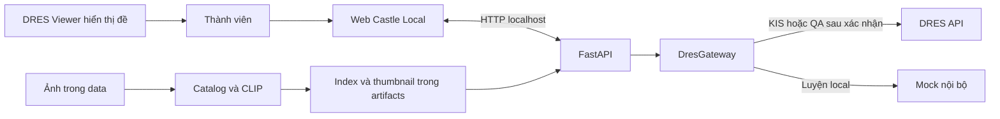

# Báo cáo dự án DS314 Castle5000

**Hiện trạng trên máy nhóm ngày 24/11/2026.** Castle Local là bản tìm kiếm ảnh chạy trên laptop Windows. Ứng dụng đã lập chỉ mục **4.971 ảnh** và hỗ trợ hai luồng nộp bài: **KIS nộp mã ảnh** và **QA nộp đáp án chữ do thành viên nhập**. Bản clone của bạn cùng nhóm phát triển thêm tìm kiếm theo vùng ảnh và QA tự động. Hai codebase đang nằm ở hai thư mục riêng.

## 1. Bài toán và vai trò của hệ thống

Castle5000 gồm 5.000 ảnh chụp từ camera tĩnh trong bếp. Nhiều frame có cùng người, vật thể và góc nhìn. Điểm khó là tìm đúng hành động hoặc thời điểm, chẳng hạn phân biệt một người **rửa tay** với người đó **rửa dụng cụ** ở cùng bồn rửa.

| Thành phần | Vai trò |
|---|---|
| **DRES Viewer** | Hiện đề, loại task, thời gian còn lại và bảng điểm. |
| **Castle Local** | Lập chỉ mục, tìm ảnh, mở ảnh lớn, duyệt frame lân cận và gửi bài khi thành viên xác nhận. |
| **Thành viên nhóm** | Đọc đề, nhập mô tả để tìm, kiểm tra ảnh và quyết định nộp ảnh hay đáp án chữ theo task. |
| **DRES API** | Nhận kết quả của nhóm. KIS được chấm tự động. QA thường chờ trọng tài chấm. |

Một lượt thi trên DRES gửi **kết quả của task**. Hệ thống Python và giao diện web của nhóm chạy trên laptop, làm nhiệm vụ tìm và gửi kết quả. Việc nộp mã nguồn, nếu có trong môn học, thuộc quy định bàn giao riêng. Tài liệu DRES mô tả QA là tìm bằng chứng và nộp chữ. Việc app phải tự sinh đáp án cần đối chiếu với rubric của môn học.

## 2. Cây thư mục trên máy local

```text
D:\UIT\DS314\
├── Final_Project\                         Castle Local của nhóm
│   ├── config.json                        Đường dẫn và cấu hình CLIP, DRES
│   ├── requirements.txt                   Thư viện Python cho app
│   ├── README_VI.md                       Cài đặt và thao tác thi
│   ├── VALIDATION.md                      Lịch sử kiểm chứng
│   ├── AGENTS.md                          Quy ước làm việc trong project
│   ├── castle\
│   │   ├── __init__.py                    Gói Python castle
│   │   ├── __main__.py                    Lệnh doctor, scan, build, serve, evaluate
│   │   ├── config.py                     Nạp cấu hình và đặt đường dẫn cache
│   │   ├── catalog.py                    Quét ảnh, đọc metadata và ánh xạ imageID
│   │   ├── model.py                      Mã hóa ảnh và chữ bằng OpenCLIP
│   │   ├── index.py                      Build, tìm kiếm và lấy frame lân cận
│   │   ├── app.py                        FastAPI, API nội bộ và phục vụ giao diện
│   │   └── dres.py                       Phiên đăng nhập, task và nộp KIS hoặc QA
│   ├── web\                              index.html, style.css, app.js
│   ├── scripts\                          setup.ps1, python.ps1, doctor.ps1,
│   │                                     build_index.ps1, start.ps1,
│   │                                     preserve_environment.py, smoke_clip.py,
│   │                                     smoke_browser.py
│   ├── tests\                            test_system.py, test_doctor.py
│   ├── data\
│   │   ├── Batch1\                       1.853 JPG nguồn
│   │   ├── Batch2\                       1.767 JPG nguồn
│   │   ├── Batch3\                       1.380 JPG nguồn
│   │   └── exclude.txt                   Danh sách 17 bảng màu loại thủ công
│   ├── evaluation\                      dev.jsonl, holdout.jsonl,
│   │                                     calibration_exclusions.txt, README.md
│   ├── notes\                            Báo cáo, ngữ cảnh, tiến độ, thực nghiệm,
│   │                                     quyết định kỹ thuật
│   ├── artifacts\                        Kết quả tạo trên máy
│   │   ├── CURRENT.json                  Chọn phiên bản index đang dùng
│   │   ├── indexes\<generation>\         embeddings.npy và manifest.json
│   │   ├── features\                     Cache embedding theo ảnh và model
│   │   ├── thumbs\                       Ảnh thu nhỏ
│   │   ├── browser\                      Báo cáo và ảnh kiểm thử Chrome
│   │   └── submissions.jsonl              Lịch sử thao tác nộp trên máy
│   ├── .cache\                           Trọng số OpenCLIP và cache tải thư viện
│   └── .runtime\                         Đường dẫn Python, constraints và công cụ test
├── castle5000-image-retrieval\            Clone GitHub của bạn cùng nhóm
│   ├── backend\app\                      Backend retrieval, QA và DRES
│   ├── backend\tests\                    Kiểm thử riêng của repo bạn
│   ├── frontend\                         Trang /search-v2/ và màn kiểm tra ảnh
│   ├── tools\                            Trình chạy local, build index và DRES demo
│   ├── runtime\                          Gói ảnh, chỉ mục và trọng số qua Git LFS
│   ├── docs\QA_EVIDENCE_FLOW.md            Mô tả pipeline QA tự động
│   ├── .env.example                      Mẫu cấu hình model, DRES và QA
│   └── README.md                         Hướng dẫn dành riêng cho repo bạn
├── Lab 1\
├── Lab 2\
└── Lab 3\
```

Python của Castle Local nằm ngoài project tại `D:\UIT\.venvs\ml-gpu\Scripts\python.exe`. `Final_Project` hiện là thư mục local chưa có Git. Thư mục `castle5000-image-retrieval` là repo Git riêng. Các thư mục dữ liệu, cache trọng số, index và runtime được giữ local theo quy ước của project.

`doctor` ngày 24/11 xác nhận Python **3.14.3**, PyTorch **2.14.1+cu130**, torchvision **0.29.2**, OpenCLIP **3.3.0**, FastAPI **0.165.0**, Uvicorn **0.54.0** và NumPy **2.5.4**. GPU là **NVIDIA GeForce RTX 3050 Laptop 6 GiB**, CUDA khả dụng. `setup.ps1` dùng constraints để giữ các bản Torch, torchvision, torchaudio, NumPy và Pillow đang cài trong venv dùng chung. `config.json` chọn `device=auto`, `batch_size=16`, collection `castle5000` và prefix `day1_Kitchen_`. `metadata_csv` đang để trống.

## 3. Dữ liệu và thuật toán tìm ảnh

| Batch | Ảnh nguồn | Đưa vào index |
|---|---:|---:|
| Batch1 | 1.853 | 1.824 |
| Batch2 | 1.767 | 1.767 |
| Batch3 | 1.380 | 1.380 |
| **Tổng** | **5.000** | **4.971** |

Audit đọc đầy đủ 5.000 ảnh JPG kích thước 1280 × 720, không phát hiện ảnh hỏng hay tên ảnh trùng. Trong 29 ảnh bảng màu được loại, 12 ảnh khớp hai hash mẫu và 17 ảnh nằm trong danh sách kiểm tra thủ công. Ảnh gốc vẫn có trong `data`. Mỗi ảnh được lập chỉ mục có một mã ảnh duy nhất trong manifest hiện tại. [Audit dữ liệu](../artifacts/data_audit.json) · [Kiểm tra index](../artifacts/final_validation.json)

**Khi build.** `catalog.py` quét ảnh đệ quy, đọc `data/exclude.txt`, áp dụng quy tắc hash và nối metadata nếu có. `index.py` kiểm tra ảnh nguồn, tạo thumbnail, lấy embedding từ cache hoặc gọi `ClipEncoder.images()`. OpenCLIP dùng `ViT-B-32` với checkpoint `laion2b_s34b_b79k`. Kết quả là ma trận `4.971 × 512` kiểu `float32`, chuẩn hóa L2. Mỗi bản build hoàn chỉnh có `embeddings.npy` và `manifest.json` riêng. `CURRENT.json` chuyển sang bản mới sau khi ghi xong.

**Khi tìm.** Trình duyệt gửi câu mô tả, bộ lọc và số kết quả tới `POST /api/search`. `SearchIndex.search()` chọn ảnh theo Batch và giờ trong tên file. CLIP mã hóa câu mô tả thành vector chuẩn hóa. NumPy tính `matrix[candidates] @ query_vector` và xếp ảnh theo cosine giảm dần. Khi chọn **Tìm ảnh tương tự**, app dùng embedding của ảnh đang mở thay cho câu mô tả. Khi để trống mô tả, app duyệt ảnh theo thứ tự frame. [Mã catalog](../castle/catalog.py) · [Mã model](../castle/model.py) · [Mã index](../castle/index.py)

CLIP tự chọn CUDA khi có và CPU khi không có. Ma trận toàn ảnh chiếm khoảng **9,71 MiB**, phù hợp với tìm kiếm chính xác bằng NumPy trên bộ dữ liệu này. Điểm cosine giúp xếp hạng. Thành viên vẫn kiểm tra động tác bằng ảnh gốc và các frame lân cận. Giờ và frame lấy từ tên file, còn Batch chỉ là cách chia thư mục.

## 4. Web local và cách chạy

`scripts/start.ps1` chọn Python đã cấu hình và gọi `python -m castle serve`. Entrypoint trong `castle/__main__.py` chạy Uvicorn. `castle/app.py` nạp index và phục vụ HTML, CSS, JavaScript từ `web/` cùng các API nội bộ. Chrome hoặc Edge mở ứng dụng tại **http://127.0.0.1:8000**. Web dùng JavaScript thuần, không cần Node hay bước build frontend.



| Việc cần làm | Lệnh trong PowerShell tại `D:\UIT\DS314\Final_Project` |
|---|---|
| Kiểm tra môi trường | `powershell -NoProfile -ExecutionPolicy Bypass -File .\scripts\doctor.ps1` |
| Cài dependency trên máy mới | `powershell -NoProfile -ExecutionPolicy Bypass -File .\scripts\setup.ps1` |
| Build lại khi đổi dữ liệu hoặc model | `powershell -NoProfile -ExecutionPolicy Bypass -File .\scripts\build_index.ps1` |
| Mở ứng dụng với index hiện có | `powershell -NoProfile -ExecutionPolicy Bypass -File .\scripts\start.ps1` |
| Đổi cổng khi cổng 8000 bận | `powershell -NoProfile -ExecutionPolicy Bypass -File .\scripts\start.ps1 -Port 8001` |

Trên máy hiện tại đã có index. Để mở lại, chỉ cần chạy `start.ps1` rồi mở URL tương ứng. Giữ terminal mở khi dùng app. Lần tìm bằng chữ đầu tiên có thể chậm vì model được nạp khi cần. Với checkpoint đã có trong cache, có thể đặt `$env:HF_HUB_OFFLINE = '1'` trước khi khởi động để chạy tìm ảnh từ cache. DRES thật vẫn cần kết nối mạng. [Hướng dẫn chạy chi tiết](../README_VI.md)

## 5. Từ nút trên web đến API DRES

`web/app.js` gọi API của FastAPI trên localhost. Khi đăng nhập DRES thật, backend dùng `httpx` để lấy `sessionId` từ DRES và giữ phiên từ xa trong RAM. Trình duyệt nhận cookie phiên của Castle Local. Sau khi người dùng chọn buổi thi, app lấy task hiện tại, hiển thị loại task và kiểm tra lại trước khi gửi. **Cập nhật task** tải lại task khi Viewer chuyển câu.

| Thao tác | API trên laptop | Đầu ra hoặc tác dụng |
|---|---|---|
| Mở trang, đọc trạng thái | `GET /`, `GET /api/status` | Giao diện, model và số ảnh trong index |
| Tìm và xem ảnh | `POST /api/search`, `GET /api/image/{key}`, `GET /api/neighbors/{key}` | Kết quả, ảnh gốc hoặc thumbnail, frame lân cận |
| Kết nối và chọn buổi thi | `POST /api/dres/login`, `GET /api/dres/evaluations`, `POST /api/dres/select` | Phiên local và lựa chọn evaluation |
| Xem task | `GET /api/dres/task` | Task hiện tại, loại KIS hoặc QA và mã đối chiếu task |
| Nộp KIS | `POST /api/dres/submit` | Backend lấy mã DRES của ảnh từ index |
| Nộp QA | `POST /api/dres/submit-text` | Backend cắt khoảng trắng và gửi đáp án chữ |
| Xem lịch sử phiên | `GET /api/dres/status` | Các lượt nộp và kết quả trả về |

Cả hai loại bài đi qua `POST https://dres.2hbread.com/api/v2/submit/{evaluation_id}?session=...`. DRES ghép bài vào task đang chạy của buổi thi. Ví dụ cấu trúc body của **KIS** và **QA**:

```json
{"answerSets":[{"answers":[{"mediaItemName":"day1_Kitchen_08_269","mediaItemCollectionName":"castle5000"}]}]}
```

```json
{"answerSets":[{"answers":[{"text":"3"}]}]}
```

`08_269.jpg` là filename local và `day1_Kitchen_08_269` là mã nộp. Khi có metadata chính thức, `catalog.py` ưu tiên cột `imageID`. Số `3` ở ví dụ QA chỉ minh họa định dạng. App chặn bài sai loại, đối chiếu task tại lúc xác nhận và lúc gửi, chặn lặp đáp án trong phiên sau khi gửi, và giữ `UNKNOWN` nếu chưa xác định được kết quả do lỗi kết nối. QA nhận `202 INDETERMINATE` khi đang chờ chấm. Với `200`, đọc `submission` để phân biệt `CORRECT` và `WRONG`.

**Luyện local.** Chọn **Kết nối luyện local**, rồi chọn `local-practice` cho KIS hoặc `local-practice-qa` cho QA. `MOCK_ACCEPTED` xác nhận thao tác và xuất hiện trong lịch sử. Với QA thật, thành viên tìm ảnh làm bằng chứng, nhập đáp án chữ và xác nhận nộp. Ảnh bằng chứng được dùng để kiểm tra tại chỗ. Payload QA chỉ gồm câu trả lời. [Mã API](../castle/app.py) · [Mã kết nối DRES](../castle/dres.py) · [Hướng dẫn nộp](../README_VI.md#5-luyện-local-và-nộp-kis-qa-qua-dres)

## 6. Hiện trạng hai hướng phát triển

| Phần | Castle Local trong `Final_Project` | Repo bạn cùng nhóm tại `c1953e5` |
|---|---|---|
| Tìm kiếm toàn ảnh | CLIP ViT-B/32, NumPy exact cosine | Cùng trọng số CLIP, FAISS `IndexFlatIP` ở tầng toàn ảnh |
| Phân biệt chi tiết | Lọc giờ hoặc Batch, xem ảnh lớn, frame lân cận và tìm ảnh tương tự | RegionCLIP đối chiếu vùng và có thể xếp hạng lại ứng viên, hiển thị khung bằng chứng |
| Câu trả lời QA | Người dùng tự đọc ảnh, nhập chữ | Pipeline QA tự động có thể lập kế hoạch, tìm ảnh, đọc bằng chứng và đề xuất đáp án khi đã cấu hình model |
| Nộp bài | Có nộp ảnh KIS và nộp chữ QA qua DRES | Bản đã clone có cả nút nộp QA. Đáp án đề xuất có thể đưa vào ô nhập để thành viên sửa và xác nhận |
| Trạng thái trên máy này | Index đã build, tìm kiếm CUDA và luyện KIS/QA đã kiểm chứng | Mã nguồn đã có, còn thiếu hai ZIP Git LFS chứa ảnh và chỉ mục. Chưa chạy app đầy đủ hoặc đo chất lượng QA tại đây |

**Phần QA đang phát triển trong repo bạn.** Tài liệu triển khai mô tả luồng tự động dùng Gemini lập kế hoạch, CLIP/RegionCLIP truy xuất ảnh và Gemini kiểm chứng dựa trên ảnh. Một số mẫu câu đếm dùng Grounding DINO để đề xuất vùng đối tượng. Cấu hình `QA_EARLY_STOP_MODE=stable_answer` là lựa chọn thử nghiệm để dừng đọc thêm ảnh khi đáp án nháp ổn định. Giá trị mặc định trong code là `rules`. Đây là chức năng trong code của repo bạn. Hiện chưa có số đo độc lập trên laptop cho khả năng trả lời đúng hoặc tốc độ của bản này. [README repo bạn](../../castle5000-image-retrieval/README.md) · [Luồng QA tự động](../../castle5000-image-retrieval/docs/QA_EVIDENCE_FLOW.md)

## 7. Kiểm chứng và các mốc đã thực hiện

| Mốc | Kết quả |
|---|---|
| **20/11** | Ổn định môi trường Windows và CLIP CUDA. Kiểm tra 5.000 ảnh, build và chuẩn hóa index 4.971 ảnh. Build CUDA đầu tiên mất 218,63 giây cho 4.988 ảnh. Lần dựng bản 4.971 ảnh dùng cache và mất 44,13 giây. |
| **22/11** | Tích hợp nộp chữ QA, nhận diện task, xác nhận, chặn nộp sai loại và lịch sử. Kiểm tra trên Chrome với KIS và QA mock, cả hủy và xác nhận. |
| **23/11** | Khởi động lại trong buổi test, tìm ảnh trên CUDA với index 4.971. Thử câu mô tả về rửa tay và rà frame lân cận. Các ảnh được xem vẫn là ứng viên. |
| **24/11** | Đếm lại thư mục ảnh và nạp kiểm tra index. Shape `4.971 × 512`, `float32`, chuẩn L2 hợp lệ, 4.971 mã duy nhất, báo cáo build không có lỗi. Chạy lại **30/30 test pass**, `doctor` pass, `pip check` sạch. Cổng 8000 không có server khi kiểm kê, dùng `start.ps1` để mở lại. |

| Phép đo | Kết quả và điều kiện |
|---|---|
| Độ trễ HTTP | p50 **32,164 ms**, p95 **58,2604 ms** với 9 query và model đã nạp. p50 **10,262 ms** khi lặp query và dùng cache vector. Không gồm thời gian nạp model hoặc trình duyệt render. |
| Mức bao phủ nhãn dev | Trong 9 query, top 50 có frame đã gán nhãn cho **1/9**, top 200 cho **2/9**, top 500 cho **5/9**. MRR@200 khoảng **0,00652**. |
| Holdout ban đầu | 3 câu, Hit@50 **0/3** với nhãn hiện có. Tập nhỏ và mỗi sự kiện có thể có nhiều frame đúng chưa được gán nhãn. |
| Kiểm thử nộp | KIS và QA mock đã qua Chrome. QA có test payload `text`, `202 INDETERMINATE`, task đổi, đáp án trùng và timeout qua HTTP giả lập. Kết quả nộp với tài khoản DRES thật chưa được xác minh trong hồ sơ kiểm thử của project. |

Khi xem trực tiếp câu *bếp vắng người*, ba ảnh đứng đầu đều phù hợp nhưng chưa thuộc danh sách nhãn. Vì vậy các chỉ số trên đo khả năng tìm lại frame đã ghi trong bộ nhãn hiện tại. Chúng hữu ích để so các lần chạy, nhưng còn thiếu để kết luận tỷ lệ giải đúng câu hỏi cuộc thi. [Thực nghiệm](EXPERIMENTS.md) · [Kết quả Chrome](../artifacts/browser/report.json) · [Tiến độ và lệnh chạy](PROGRESS.md)

## 8. Phần còn lại và thứ tự phát triển

Lịch triển khai cho hai thành viên, thiết kế nhận và dịch gợi ý theo từng mức 30 giây, tiêu chí chọn model và quy trình thi thử local nằm trong [kế hoạch thực hiện đồ án](KE_HOACH_THUC_HIEN.md). Kế hoạch có một phép thử bốn mức trên index thật và phân biệt phần đã chạy với phần còn phải triển khai.

1. **Xác minh buổi luyện DRES thật.** Dùng tài khoản được cấp và task do BTC mở. Ghi nhận loại task, loại bài, phản hồi `submission` và cách xử lý khi Viewer chuyển câu. Giữ thông tin phiên và mật khẩu ngoài báo cáo.
2. **Mở rộng bộ đánh giá tìm ảnh.** Gán nhiều frame đúng theo từng sự kiện. Đo khả năng giữ ảnh đúng trong top ứng viên, Hit@K và thời gian chọn ảnh. Giữ riêng một tập câu để kiểm tra sau khi chỉnh model hoặc ngưỡng.
3. **So sánh lợi ích của tìm theo vùng.** Chuẩn bị runtime của repo bạn, đối chiếu tập ảnh chung rồi so CLIP-only và CLIP + RegionCLIP với cùng mô tả và nhãn. Đo cả khi rerank 100, 200 và 500 ứng viên để thấy chi phí và khả năng bỏ sót frame.
4. **Kiểm thử QA tự động theo hai bước.** Trước tiên đưa ảnh đã biết đáp án cho model để đo lỗi đọc ảnh. Sau đó để hệ thống tự truy xuất rồi đo lỗi theo từng tầng: tìm frame, đọc chi tiết và tạo đáp án. Hiển thị ảnh làm bằng chứng và giữ nút xác nhận nộp. Nếu rubric yêu cầu tự trả lời, dùng kết quả này để quyết định tích hợp module QA nào.
5. **Hoàn thiện thao tác trước khi bàn giao.** Thử tăng tốc chọn frame bằng phím trái/phải và ghim ứng viên để so sánh. Hoàn thiện hướng dẫn chạy cho máy khác và thống nhất cách phiên bản hóa `Final_Project` nếu nhóm muốn phát triển chung trên Git.

Thông số môi trường và các quyết định giữ baseline nằm trong [ngữ cảnh kỹ thuật](PROJECT_CONTEXT.md) và [quyết định kỹ thuật](DECISIONS.md). Quy cách nộp KIS và QA lấy từ `DRES_HuongDan_Castle5000_QA.pdf`, mục 6–10.
